<a id="atas"></a>

<div align="center">

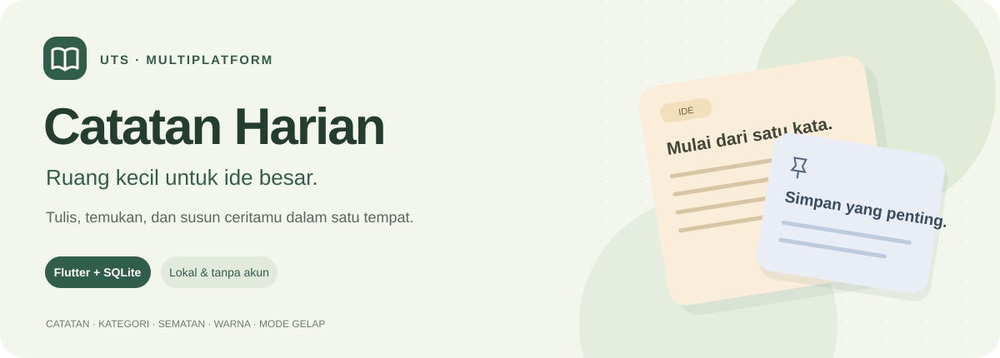

# Catatan Harian

**Tulis ide. Simpan cerita. Susun hari dengan lebih teratur.**

Aplikasi catatan lokal berbasis Flutter dengan kategori, sematan, warna kartu, dan mode gelap.

<p>
  
  
  
  
  
</p>

[Galeri tampilan](#galeri) · [Mulai menjalankan](#instalasi) · [Panduan penggunaan](#penggunaan) · [Laporan Word](laporan/Laporan_Catatan_Harian_Muhammad_Alif_Mujaddid.docx) · [Laporan PDF](laporan/Laporan_Catatan_Harian_Muhammad_Alif_Mujaddid.pdf)

</div>

---

<a id="tentang"></a>

## Tentang aplikasi

**Catatan Harian** membantu pengguna mencatat ide, materi belajar, rencana kegiatan, dan cerita sehari-hari dalam satu tempat. Catatan dapat dicari melalui judul atau isi, dikelompokkan berdasarkan kategori, serta disematkan agar mudah ditemukan kembali.

Aplikasi menggunakan **SQLite** untuk menyimpan catatan dan **Shared Preferences** untuk menyimpan preferensi tema serta urutan. Pengguna dapat membuat dan mengelola catatan tanpa akun maupun koneksi internet.

Proyek ini disusun untuk pembelajaran **Multiplatform**, dengan penerapan antarmuka Flutter, navigasi antarlayar, pengelolaan state, operasi asinkron, penyimpanan lokal, dan pengujian otomatis. Antarmuka memakai Material 3 dengan nuansa sage dan krem, empat warna kartu, serta tema gelap.

| Ringkasan proyek       | Keterangan                                                   |
| ---------------------- | ------------------------------------------------------------ |
| Nama aplikasi          | Catatan Harian                                               |
| Nama package Dart      | `uts`                                                        |
| Versi aplikasi         | `1.0.0+1`                                                    |
| Bahasa dan framework   | Dart dan Flutter                                             |
| Penyimpanan catatan    | SQLite, database `catatan.db`                                |
| Penyimpanan preferensi | Shared Preferences                                           |
| Fokus verifikasi build | Android, APK debug berhasil dibuat                           |
| Pemeriksaan terakhir   | 23 Oktober 2026: 14 tes lulus, analisis statis tanpa masalah |
| Dokumentasi tambahan   | Laporan Word 12 halaman, PDF, dan 8 screenshot               |

> Badge dan hasil pemeriksaan di README merupakan catatan verifikasi pada tanggal di atas, bukan status CI yang diperbarui otomatis. Rincian dukungan platform tersedia pada bagian [platform](#platform).

<a id="daftar-isi"></a>

## Daftar isi

1. [Tentang aplikasi](#tentang)
2. [Fitur utama](#fitur)
3. [Galeri screenshot](#galeri)
4. [Desain dan palet warna](#desain)
5. [Teknologi dan dependensi](#teknologi)
6. [Persiapan dan instalasi](#instalasi)
7. [Dukungan platform](#platform)
8. [Panduan penggunaan](#penggunaan)
9. [Arsitektur dan alur aplikasi](#arsitektur)
10. [Struktur proyek](#struktur)
11. [Database dan preferensi](#database)
12. [Pengujian dan hasil verifikasi](#pengujian)
13. [Build dan instalasi APK](#build-apk)
14. [Laporan dan aset dokumentasi](#dokumentasi)
15. [Pemecahan masalah](#troubleshooting)
16. [Batasan dan rencana pengembangan](#pengembangan)
17. [Identitas pengembang](#pengembang)

---

<a id="fitur"></a>

## Fitur utama

### Menulis dan mengelola catatan

| Fitur                | Perilaku yang tersedia                                                                      |
| -------------------- | ------------------------------------------------------------------------------------------- |
| Tambah catatan       | Menulis judul dan isi lalu menyimpannya ke SQLite.                                          |
| Baca dan edit        | Mengetuk kartu untuk membuka editor dengan data catatan yang sudah ada.                     |
| Hapus catatan        | Menghapus melalui menu kartu setelah menyetujui dialog konfirmasi.                          |
| Validasi form        | Menolak judul dan isi yang kosong, termasuk isian yang hanya berisi spasi.                  |
| Penghitung kata      | Menampilkan jumlah kata pada editor dan kartu berdasarkan isi catatan.                      |
| Konfirmasi perubahan | Meminta keputusan pengguna ketika editor ditinggalkan dengan perubahan yang belum disimpan. |

### Menata koleksi

| Fitur             | Perilaku yang tersedia                                                         |
| ----------------- | ------------------------------------------------------------------------------ |
| Pencarian         | Menelusuri judul dan isi tanpa membedakan huruf besar/kecil.                   |
| Kategori          | Pilihan **Pribadi**, **Kuliah**, **Kerja**, dan **Ide**.                       |
| Filter gabungan   | Memakai kata kunci, kategori, dan status sematan secara bersamaan.             |
| Sematkan catatan  | Memprioritaskan catatan penting di bagian atas koleksi.                        |
| Urutan waktu      | Memilih terbaru atau terlama; catatan yang disematkan tetap berada di atas.    |
| Grid dan daftar   | Mengubah tata letak koleksi; grid menyesuaikan jumlah kolom dengan lebar area. |
| Ringkasan beranda | Menampilkan total catatan dan jumlah catatan yang dibuat hari ini.             |
| Muat ulang        | Menarik beranda ke bawah untuk memuat ulang catatan dari database.             |

### Personalisasi dan umpan balik

| Fitur                | Perilaku yang tersedia                                                                 |
| -------------------- | -------------------------------------------------------------------------------------- |
| Tema terang/gelap    | Mengganti tema melalui ikon di kanan atas beranda.                                     |
| Warna kartu          | Memilih palet **Sage**, **Pasir**, **Langit**, atau **Rose**.                          |
| Preferensi tersimpan | Tema serta urutan terbaru/terlama dipulihkan ketika aplikasi dibuka kembali.           |
| Indikator proses     | Menampilkan loading saat memuat dan status menyimpan pada editor.                      |
| Penanganan kegagalan | Menampilkan pesan ketika operasi gagal atau melewati batas waktu.                      |
| Coba lagi            | Menyediakan tombol untuk memuat ulang koleksi setelah gagal memuat.                    |
| Keadaan kosong       | Membedakan koleksi yang belum berisi catatan dengan hasil filter yang tidak ditemukan. |

[↑ Kembali ke atas](#atas)

---

<a id="galeri"></a>

## Galeri screenshot

Delapan gambar berikut diambil dari **render widget Flutter aplikasi yang sebenarnya**, menggunakan data demonstrasi. Setiap gambar dapat diklik untuk melihat PNG ukuran penuh.

Viewport pengambilan berukuran **420 × 860 piksel logis**, dengan hasil gambar **840 × 1720 piksel**. Screenshot dihasilkan melalui lingkungan pengujian Flutter; gambar tidak menampilkan bilah sistem Android dan bukan tangkapan dari perangkat fisik.

### Beranda: terang dan gelap

<table>
  <tr><th align="center">Tema terang</th><th align="center">Tema gelap</th></tr>
  <tr>
    <td align="center"><a href="laporan/screenshots/01_beranda_terang.png">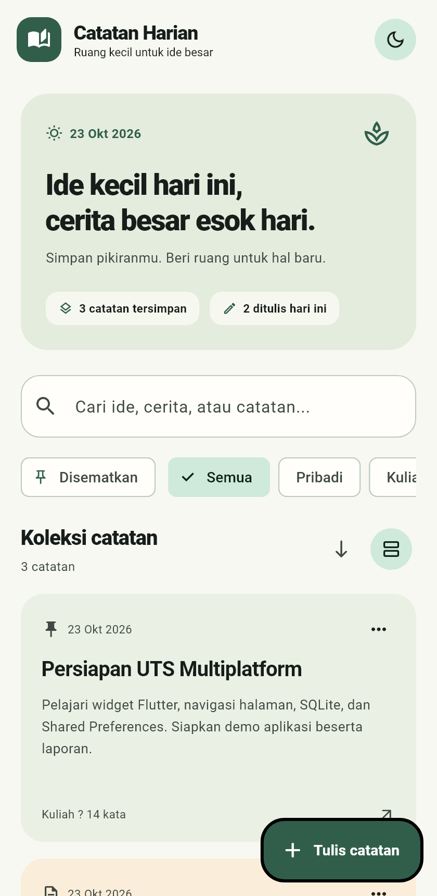</a></td>
    <td align="center"><a href="laporan/screenshots/02_beranda_gelap.png">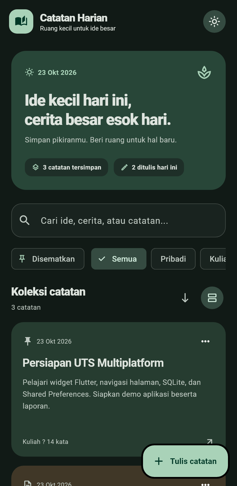</a></td>
  </tr>
  <tr><td align="center">Ringkasan, pencarian, filter, dan tombol tulis dalam nuansa sage.</td><td align="center">Tema gelap memakai warna permukaan dan kartu yang disesuaikan.</td></tr>
</table>

### Editor dan pengaturan catatan

<table>
  <tr><th align="center">Editor catatan</th><th align="center">Panel pengaturan</th></tr>
  <tr>
    <td align="center"><a href="laporan/screenshots/03_editor_catatan.png">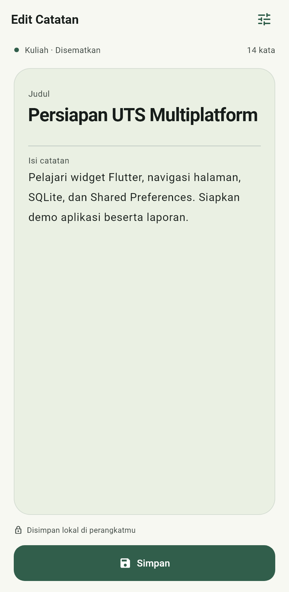</a></td>
    <td align="center"><a href="laporan/screenshots/04_pengaturan_catatan.png">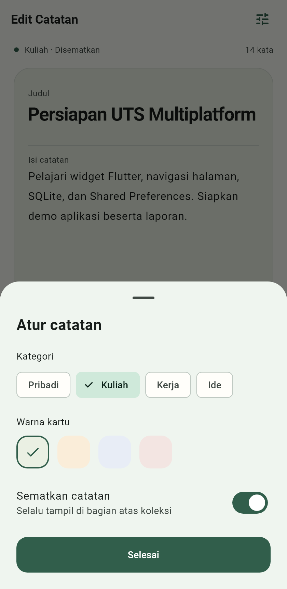</a></td>
  </tr>
  <tr><td align="center">Area menulis dengan penghitung kata dan penyimpanan manual.</td><td align="center">Kategori, warna, dan sematan dapat diatur dari satu panel.</td></tr>
</table>

### Pencarian dan filter gabungan

<table>
  <tr><th align="center">Pencarian kata kunci</th><th align="center">Kategori + sematan</th></tr>
  <tr>
    <td align="center"><a href="laporan/screenshots/05_pencarian.png">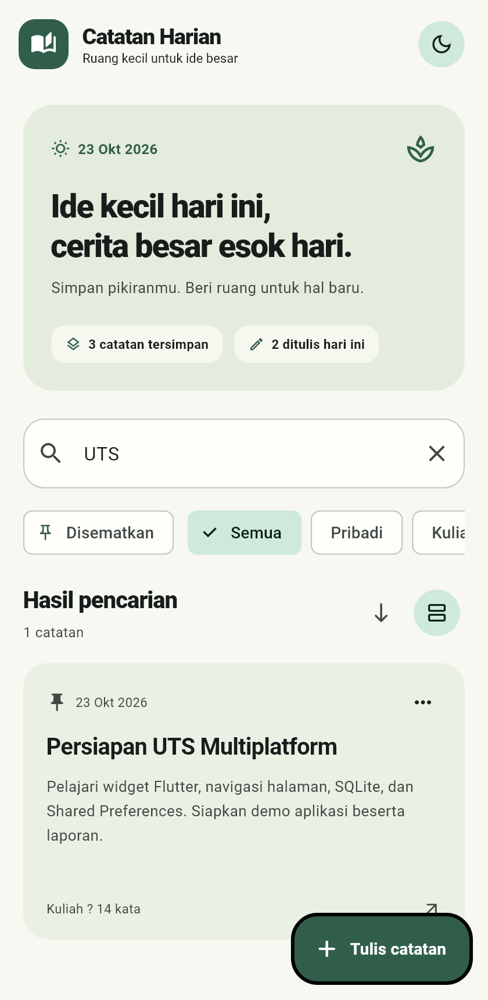</a></td>
    <td align="center"><a href="laporan/screenshots/06_filter_kategori_sematan.png">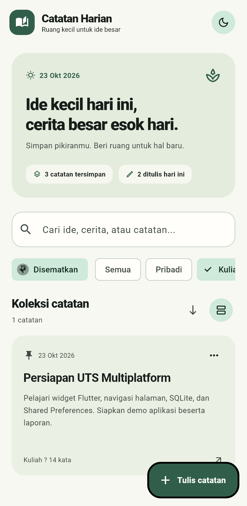</a></td>
  </tr>
  <tr><td align="center">Judul maupun isi dapat dicari tanpa memperhatikan kapital.</td><td align="center">Hasil memuat catatan yang sesuai dengan seluruh filter aktif.</td></tr>
</table>

### Validasi dan konfirmasi

<table>
  <tr><th align="center">Validasi isian</th><th align="center">Konfirmasi hapus</th></tr>
  <tr>
    <td align="center"><a href="laporan/screenshots/07_validasi_form.png">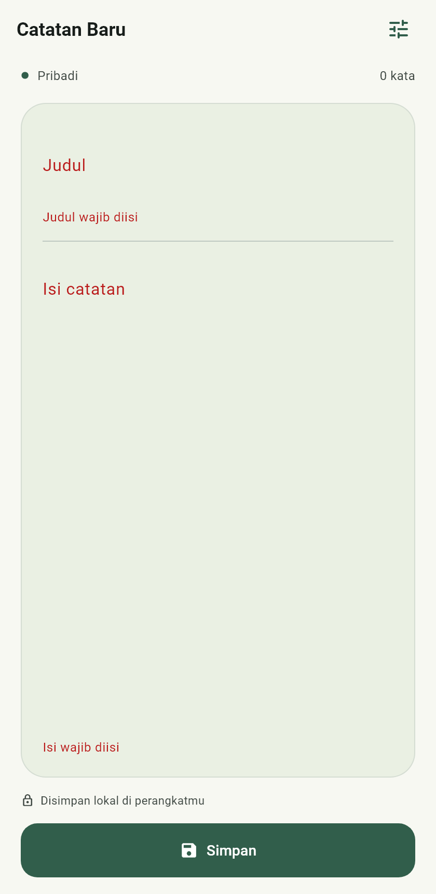</a></td>
    <td align="center"><a href="laporan/screenshots/08_konfirmasi_hapus.png">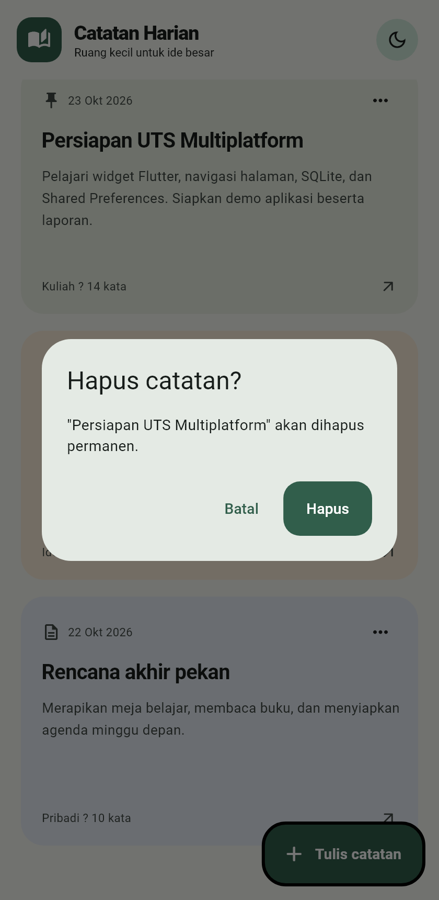</a></td>
  </tr>
  <tr><td align="center">Data kosong tidak diteruskan ke penyimpanan.</td><td align="center">Penghapusan dijalankan setelah pengguna mengonfirmasi.</td></tr>
</table>

**Unduh seluruh gambar:** [Screenshots_Catatan_Harian.zip](laporan/Screenshots_Catatan_Harian.zip).

[↑ Kembali ke atas](#atas)

---

<a id="desain"></a>

## Desain dan palet warna

Desain aplikasi mengutamakan area menulis yang lapang, hierarki judul yang jelas, tombol utama yang mudah ditemukan, serta kartu dengan sudut membulat. Warna sage digunakan sebagai identitas utama, sedangkan krem menjadi latar tema terang.

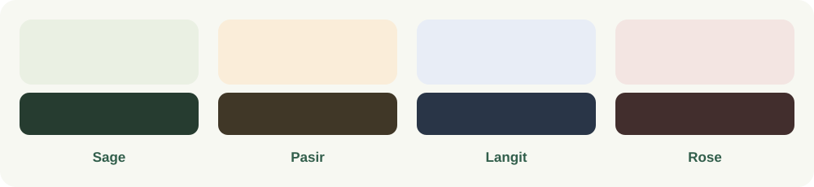

| Warna kartu | Tema terang | Tema gelap | Indeks penyimpanan |
| ----------- | ----------- | ---------- | ------------------ |
| Sage        | `#EAF0E3`   | `#263C30`  | `0`                |
| Pasir       | `#FAEDD9`   | `#403727`  | `1`                |
| Langit      | `#E8EDF6`   | `#293547`  | `2`                |
| Rose        | `#F3E5E2`   | `#422E2D`  | `3`                |

Warna utama adalah `#315E4B`. Pemilihan warna kartu bersifat visual dan terpisah dari kategori: catatan Kuliah, misalnya, tidak wajib memakai warna tertentu. Gaya komponen dan palet terpusat di [app_theme.dart](lib/theme/app_theme.dart).

Pada mode grid, jumlah kolom mengikuti **lebar area koleksi setelah padding**:

| Lebar area koleksi           | Jumlah kolom |
| ---------------------------- | ------------ |
| Kurang dari 520 piksel logis | 1            |
| 520–849 piksel logis         | 2            |
| Mulai 850 piksel logis       | 3            |
| Mode daftar                  | Selalu 1     |

---

<a id="teknologi"></a>

## Teknologi dan dependensi

| Komponen             | Versi/acuan proyek                           | Peran                                  |
| -------------------- | -------------------------------------------- | -------------------------------------- |
| Flutter              | Diperiksa dengan `3.35.5`                    | Framework antarmuka dan aplikasi.      |
| Dart                 | Diperiksa dengan `3.9.2`; batas SDK `^3.9.2` | Bahasa pemrograman.                    |
| Material 3           | `useMaterial3: true`                         | Komponen, tema, dan interaksi.         |
| `sqflite`            | `^2.4.2`                                     | Operasi SQLite lokal.                  |
| `path`               | `^1.9.1`                                     | Menyusun lokasi file database.         |
| `shared_preferences` | `^2.5.5`                                     | Menyimpan preferensi boolean.          |
| `cupertino_icons`    | `^1.0.8`                                     | Paket ikon yang tersedia dalam proyek. |
| `flutter_test`       | Dari Flutter SDK                             | Pengujian interaksi widget.            |
| `sqflite_common_ffi` | `^2.3.7+1`, dependensi pengembangan          | Backend database pada pengujian.       |
| `flutter_lints`      | `^5.0.0`                                     | Aturan analisis statis Dart/Flutter.   |

Nilai dengan awalan `^` merupakan **batas versi pada deklarasi dependensi**, bukan jaminan versi yang persis terpasang. Deklarasi tersedia di [pubspec.yaml](pubspec.yaml), sedangkan hasil resolusi tercatat di [pubspec.lock](pubspec.lock).

Aplikasi tidak memerlukan server backend, API key, file `.env`, atau akun untuk fungsi pencatatan yang tersedia saat ini.

---

<a id="instalasi"></a>

## Persiapan dan instalasi

### 1. Siapkan lingkungan

Untuk menjalankan aplikasi Android, siapkan:

- Flutter SDK; lingkungan yang telah diverifikasi memakai **Flutter 3.35.5** dan **Dart 3.9.2**.
- Android SDK dan toolchain Android yang terdeteksi oleh Flutter.
- Perangkat Android dengan USB debugging, atau emulator Android yang sudah berjalan.
- Editor, misalnya Android Studio atau Visual Studio Code dengan dukungan Flutter.

Jalankan pemeriksaan awal:

```sh
flutter --version
flutter doctor
```

Gunakan instalasi Flutter yang sama saat mengambil dependensi, menjalankan aplikasi, menganalisis, menguji, dan membuat APK. Hal ini penting jika komputer memiliki lebih dari satu Flutter SDK.

### 2. Buka direktori proyek

Buka terminal pada folder yang berisi `pubspec.yaml`. Jika terminal masih berada di folder induknya:

```sh
cd uts
```

Perintah berikut dijalankan dari direktori tersebut. Database tidak perlu dibuat secara manual karena aplikasi menyiapkannya saat pertama digunakan.

### 3. Ambil dependensi

```sh
flutter pub get
```

Koneksi internet mungkin diperlukan untuk mengunduh paket yang belum ada di cache. Setelah dependensi tersedia dan aplikasi berjalan, pengelolaan catatan dilakukan secara lokal.

### 4. Periksa perangkat

```sh
flutter devices
```

Hubungkan perangkat atau nyalakan emulator terlebih dahulu. Salin ID perangkat Android yang muncul jika lebih dari satu target tersedia.

### 5. Jalankan aplikasi

```sh
flutter run
```

Untuk memilih perangkat secara eksplisit, ganti `<device-id>` dengan ID dari `flutter devices`:

```sh
flutter run -d <device-id>
```

Selama proses pengembangan melalui `flutter run`, tombol `r` pada terminal menjalankan hot reload dan `R` menjalankan hot restart.

---

<a id="platform"></a>

## Dukungan platform

Folder platform tersedia dalam proyek Flutter, tetapi ketersediaan folder belum berarti seluruh alur aplikasi telah diverifikasi pada platform tersebut.

| Platform | Konfigurasi penyimpanan aplikasi                      | Status verifikasi                                                                       |
| -------- | ----------------------------------------------------- | --------------------------------------------------------------------------------------- |
| Android  | Menggunakan `sqflite`.                                | APK debug berhasil dibuat; pengujian perangkat fisik belum didokumentasikan.            |
| iOS      | Menggunakan backend `sqflite` untuk platform terkait. | Belum diverifikasi pada pengerjaan ini; membutuhkan lingkungan build Apple yang sesuai. |
| macOS    | Menggunakan backend `sqflite` untuk platform terkait. | Belum diverifikasi pada pengerjaan ini.                                                 |
| Windows  | Backend SQLite aplikasi belum diinisialisasi.         | Memerlukan konfigurasi tambahan.                                                        |
| Linux    | Backend SQLite aplikasi belum diinisialisasi.         | Memerlukan konfigurasi tambahan.                                                        |
| Web      | Backend penyimpanan web belum dikonfigurasi.          | Memerlukan konfigurasi tambahan.                                                        |

`sqflite_common_ffi` saat ini berada pada **dev_dependencies** dan dipakai untuk pengujian database. Paket tersebut belum dijadikan backend penyimpanan aplikasi Windows atau Linux.

---

<a id="penggunaan"></a>

## Panduan penggunaan

### Membuat catatan pertama

1. Buka beranda dan tekan **Tulis catatan**. Pada koleksi kosong, tersedia juga tombol **Tulis catatan pertama**.
2. Isi kolom **Judul** dengan nama yang mudah dikenali.
3. Tulis informasi pada **Isi catatan**. Jumlah kata akan mengikuti isi yang ditulis.
4. Jika perlu, buka ikon **Atur catatan** di kanan atas editor.
5. Tentukan kategori, warna, dan status sematan, lalu tekan **Selesai**.
6. Tekan **Simpan** pada editor. Setelah berhasil, aplikasi kembali ke beranda dan memuat ulang koleksi.

**Selesai** pada panel pengaturan hanya menutup panel. Penyimpanan seluruh perubahan dilakukan melalui tombol **Simpan** pada editor; aplikasi belum menyediakan autosave.

### Mengedit catatan

Ketuk kartu atau pilih **Edit catatan** pada menu tiga titik. Editor akan menampilkan isi beserta pengaturan yang telah disimpan. Setelah mengubah data, tekan **Simpan**.

Waktu pembuatan catatan dipertahankan ketika mengedit. Karena model belum mempunyai kolom `updated_at`, urutan koleksi tetap berdasarkan waktu pembuatan, bukan waktu perubahan terakhir.

Jika pengguna kembali sebelum menyimpan perubahan, aplikasi menampilkan dialog dengan pilihan **Tetap menulis** atau **Tinggalkan**. Pilihan kedua membuang perubahan editor yang belum disimpan.

### Memilih kategori dan warna

Buka **Atur catatan** pada editor, kemudian pilih salah satu kategori berikut:

| Kategori | Contoh penggunaan                                              |
| -------- | -------------------------------------------------------------- |
| Pribadi  | Jurnal singkat, rencana akhir pekan, atau daftar kegiatan.     |
| Kuliah   | Ringkasan materi, persiapan ujian, dan ide tugas.              |
| Kerja    | Rencana pekerjaan, catatan rapat, atau poin tindak lanjut.     |
| Ide      | Konsep proyek, inspirasi, dan gagasan yang ingin dikembangkan. |

Empat kategori tersebut merupakan pilihan tetap pada aplikasi saat ini. Pengguna dapat memilih warna kartu secara terpisah sesuai selera.

### Menyematkan catatan penting

Tersedia dua cara untuk mengubah status sematan:

- Aktifkan **Sematkan catatan** pada panel pengaturan editor, lalu simpan.
- Buka menu tiga titik pada kartu dan pilih **Sematkan catatan** atau **Lepas sematan**.

Catatan yang disematkan selalu berada sebelum catatan lainnya. Mengubah urutan menjadi terlama tidak memindahkan catatan yang disematkan ke bawah.

### Mencari dan memfilter

Gunakan kolom pencarian untuk mencari judul atau isi. Pencarian tidak membedakan kapital, sehingga `UTS`, `uts`, dan `Uts` menghasilkan kecocokan yang sama.

Filter dapat digabungkan, misalnya:

```text
Kata kunci: UTS
Kategori: Kuliah
Disematkan: aktif

Hasil: catatan yang memuat UTS pada judul atau isi,
       berkategori Kuliah, dan sedang disematkan.
```

Tombol silang membersihkan kata kunci pencarian. Jika tidak ada hasil, tombol **Reset filter** pada keadaan kosong mengembalikan kata kunci, kategori, dan filter sematan ke kondisi awal. Deretan filter dapat digeser horizontal pada layar kecil.

### Mengubah tampilan, urutan, dan tema

| Kontrol                        | Efek                              |
| ------------------------------ | --------------------------------- |
| Tombol panah pada koleksi      | Mengubah urutan terbaru/terlama.  |
| Tombol tata letak              | Beralih antara grid dan daftar.   |
| Ikon bulan/matahari di beranda | Mengganti tema terang/gelap.      |
| Tarik beranda ke bawah         | Memuat ulang koleksi dari SQLite. |

Tema dan urutan disimpan sebagai preferensi. Grid/daftar, kata kunci, dan filter saat ini hanya disimpan pada state layar selama pengguna memakainya.

### Menghapus catatan

Buka menu tiga titik pada kartu, pilih **Hapus catatan**, lalu baca judul yang muncul pada dialog. Tekan **Batal** untuk mempertahankan catatan atau **Hapus** untuk melanjutkan.

Penghapusan yang berhasil bersifat permanen pada koleksi saat ini. Fitur tempat sampah dan pemulihan belum tersedia.

[↑ Kembali ke atas](#atas)

---

<a id="arsitektur"></a>

## Arsitektur dan alur aplikasi

### Pembagian tanggung jawab

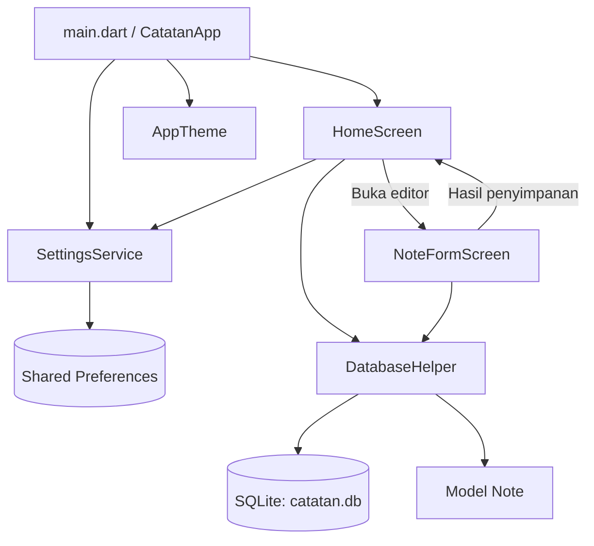

| Bagian            | Tanggung jawab                                                               |
| ----------------- | ---------------------------------------------------------------------------- |
| `CatatanApp`      | Menginisialisasi aplikasi, membaca tema, dan menyediakan `MaterialApp`.      |
| `HomeScreen`      | Memuat koleksi, mencari, memfilter, mengurutkan, serta menangani aksi kartu. |
| `NoteFormScreen`  | Mengelola isian, validasi, pilihan kategori/warna, dan penyimpanan catatan.  |
| `Note`            | Merepresentasikan data dan mengonversi antara objek Dart dengan `Map`.       |
| `DatabaseHelper`  | Menginisialisasi database, menjalankan migrasi, dan menyediakan CRUD.        |
| `SettingsService` | Membaca serta menulis preferensi tema dan urutan.                            |
| `AppTheme`        | Memusatkan warna, gaya komponen, serta tema terang/gelap.                    |

Pengelolaan state antarmuka menggunakan **StatefulWidget** dan **setState**. Navigasi editor menggunakan `Navigator` dengan `MaterialPageRoute`, sedangkan operasi database memakai `Future` dan `async/await`.

### Alur penyimpanan

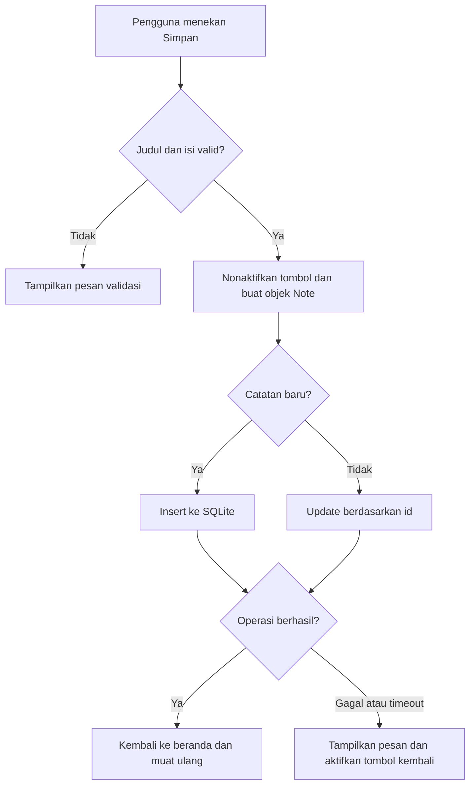

### Penanganan proses asinkron

Pemuatan dan penyimpanan memiliki indikator proses. Operasi memuat, menyimpan, menghapus, dan memperbarui sematan dibatasi **15 detik** agar pengguna mendapat umpan balik ketika proses terlalu lama.

Batas waktu pada `Future` tidak menjamin pembatalan operasi database yang sudah berjalan. Karena itu, pesan timeout penyimpanan meminta pengguna memeriksa daftar catatan. Pemeriksaan `mounted` digunakan sebelum memperbarui state setelah operasi asinkron selesai.

---

<a id="struktur"></a>

## Struktur proyek

```text
uts/
├── lib/
│   ├── main.dart                        # Entry point, aplikasi, dan tema aktif
│   ├── models/
│   │   └── note.dart                    # Model, toMap, fromMap, dan copyWith
│   ├── db/
│   │   └── database_helper.dart         # SQLite, migrasi skema, dan CRUD
│   ├── screens/
│   │   ├── home_screen.dart             # Koleksi, pencarian, filter, dan aksi kartu
│   │   └── note_form_screen.dart        # Editor, pengaturan, dan validasi
│   ├── services/
│   │   └── settings_service.dart        # Tema dan urutan melalui Shared Preferences
│   └── theme/
│       └── app_theme.dart               # Tema dan palet warna
├── test/
│   ├── database_helper_test.dart        # 3 tes database
│   ├── home_screen_test.dart            # 4 tes beranda
│   └── widget_test.dart                 # 7 tes editor
├── docs/
│   └── assets/                          # Banner, badge, dan palet untuk README
├── laporan/
│   ├── screenshots/                     # 8 gambar PNG tampilan aplikasi
│   ├── Laporan_...docx                  # Laporan Word yang dapat diedit
│   ├── Laporan_...pdf                   # Versi PDF laporan
│   ├── Screenshots_Catatan_Harian.zip    # Arsip screenshot terpisah
│   ├── hasil_analisis.txt               # Bukti analisis statis
│   ├── hasil_pengujian.txt              # Bukti tes fungsional
│   └── README.md                        # Keterangan berkas laporan
├── tools/
│   ├── report_capture_test.dart         # Harness pengambilan screenshot
│   ├── create_report.py                 # Penyusun dokumen Word
│   ├── render_report.py                 # Ekspor PDF melalui Microsoft Word
│   ├── check_report.py                  # Pemeriksaan halaman dan pratinjau PDF
│   └── generate_readme_assets.py        # Pembuat aset SVG dokumentasi
├── android/                             # Konfigurasi platform Android
├── ios/                                 # Konfigurasi platform iOS
├── macos/                               # Konfigurasi platform macOS
├── windows/                             # Konfigurasi platform Windows
├── linux/                               # Konfigurasi platform Linux
├── web/                                 # Konfigurasi platform web
├── pubspec.yaml                         # Metadata dan batas versi dependensi
├── pubspec.lock                         # Versi dependensi hasil resolusi
├── analysis_options.yaml                # Aturan analisis Dart
└── README.md
```

Nama laporan pada diagram disingkat untuk menjaga keterbacaan. Berkas lengkap dapat diakses melalui bagian [laporan dan aset dokumentasi](#dokumentasi).

---

<a id="database"></a>

## Database dan preferensi

### Model catatan

Setiap objek `Note` memiliki identitas opsional, judul, isi, waktu pembuatan, kategori, indeks warna, dan status sematan. Contoh berikut menunjukkan data dengan struktur yang sama seperti model aplikasi:

```dart
final note = Note(
  title: 'Persiapan UTS Multiplatform',
  content: 'Pelajari widget Flutter, SQLite, dan Shared Preferences.',
  category: 'Kuliah',
  colorIndex: 0,
  isPinned: true,
);
```

Contoh tersebut hanya membentuk objek. Untuk menyimpannya, aplikasi memanggil operasi `insert` pada `DatabaseHelper`. Nilai `id` dibuat oleh SQLite dan `createdAt` menggunakan waktu saat objek dibuat jika tidak diberikan secara eksplisit.

### Skema SQLite

| Properti database | Nilai                                                 |
| ----------------- | ----------------------------------------------------- |
| Nama file         | `catatan.db`                                          |
| Versi skema       | `2`                                                   |
| Nama tabel        | `notes`                                               |
| Lokasi            | Direktori database aplikasi dari `getDatabasesPath()` |
| Inisialisasi      | Dibuat otomatis saat akses database pertama           |

```sql
CREATE TABLE notes (
  id INTEGER PRIMARY KEY AUTOINCREMENT,
  title TEXT NOT NULL,
  content TEXT NOT NULL,
  created_at TEXT NOT NULL,
  category TEXT NOT NULL DEFAULT 'Pribadi',
  color_index INTEGER NOT NULL DEFAULT 0,
  is_pinned INTEGER NOT NULL DEFAULT 0
);
```

| Kolom         | Representasi | Keterangan                                               |
| ------------- | ------------ | -------------------------------------------------------- |
| `id`          | `INTEGER`    | Identitas unik, bertambah otomatis.                      |
| `title`       | `TEXT`       | Judul catatan.                                           |
| `content`     | `TEXT`       | Isi catatan.                                             |
| `created_at`  | `TEXT`       | Waktu pembuatan dalam format ISO 8601.                   |
| `category`    | `TEXT`       | Kategori; nilai awal `Pribadi`.                          |
| `color_index` | `INTEGER`    | Indeks palet `0` sampai `3` pada pilihan warna aplikasi. |
| `is_pinned`   | `INTEGER`    | `1` untuk disematkan dan `0` untuk tidak.                |

### Operasi CRUD

| Metode                                | Fungsi                                                     |
| ------------------------------------- | ---------------------------------------------------------- |
| `getNotes({bool newestFirst = true})` | Membaca catatan dengan prioritas sematan dan urutan waktu. |
| `insert(Note note)`                   | Menambahkan catatan dan mengembalikan ID hasil insert.     |
| `update(Note note)`                   | Memperbarui data yang memiliki ID sesuai.                  |
| `delete(int id)`                      | Menghapus catatan berdasarkan ID.                          |

Update dan delete memakai `where: 'id = ?'` dengan `whereArgs`. Waktu pembuatan dipertahankan ketika catatan diedit. Detail implementasi ada di [database_helper.dart](lib/db/database_helper.dart).

### Migrasi database

Saat database versi 1 dibuka oleh aplikasi dengan skema versi 2, `onUpgrade` menambahkan tiga kolom:

```sql
ALTER TABLE notes ADD COLUMN category TEXT NOT NULL DEFAULT 'Pribadi';
ALTER TABLE notes ADD COLUMN color_index INTEGER NOT NULL DEFAULT 0;
ALTER TABLE notes ADD COLUMN is_pinned INTEGER NOT NULL DEFAULT 0;
```

Migrasi tersebut mempertahankan tabel serta isi catatan lama. Catatan lama memperoleh kategori Pribadi, warna indeks 0, dan status tidak disematkan. Pengujian migrasi memeriksa data lama, nilai awal, serta urutan setelah status sematan diperbarui.

### Shared Preferences dan state layar

| Nilai                                       | Tempat penyimpanan          | Bertahan saat aplikasi dibuka ulang? |
| ------------------------------------------- | --------------------------- | ------------------------------------ |
| Judul, isi, waktu, kategori, warna, sematan | SQLite                      | Ya.                                  |
| Tema, key `dark_mode`                       | Shared Preferences          | Ya.                                  |
| Urutan, key `sort_newest`                   | Shared Preferences          | Ya.                                  |
| Tampilan grid/daftar                        | State `HomeScreen`          | Tidak dipersistenkan.                |
| Kata kunci dan filter aktif                 | State `HomeScreen`          | Tidak dipersistenkan.                |
| Perubahan editor sebelum Simpan             | Controller dan state editor | Belum tersimpan.                     |

Pengaturan awal adalah tema terang dan urutan terbaru. Seluruh fungsi pencatatan yang tersedia bekerja pada penyimpanan lokal; belum ada sinkronisasi akun atau cadangan melalui ekspor/impor.

[↑ Kembali ke atas](#atas)

---

<a id="pengujian"></a>

## Pengujian dan hasil verifikasi

### Menjalankan pemeriksaan

```sh
flutter analyze
flutter test
```

Jika dependensi sudah tersedia dan sesuai dengan Flutter SDK yang aktif, pemeriksaan dapat dijalankan tanpa pengambilan dependensi ulang:

```sh
flutter analyze --no-pub
flutter test --no-pub
```

### Cakupan tes

| Berkas                                                      | Jumlah | Skenario yang diperiksa                                                                                                                                             |
| ----------------------------------------------------------- | ------ | ------------------------------------------------------------------------------------------------------------------------------------------------------------------- |
| [database_helper_test.dart](test/database_helper_test.dart) | 3      | CRUD, inisialisasi database yang dibagi antarpemanggil, migrasi data lama dan prioritas sematan.                                                                    |
| [home_screen_test.dart](test/home_screen_test.dart)         | 4      | Filter kategori + sematan pada layar kecil, pencarian dan pembersihan, gagal memuat lalu coba lagi, batas waktu pemuatan.                                           |
| [widget_test.dart](test/widget_test.dart)                   | 7      | Simpan kategori/warna/sematan, layar kecil dengan keyboard, konfirmasi perubahan, validasi, kegagalan simpan, batas waktu simpan, penyimpanan berhasil dan kembali. |
| **Total**                                                   | **14** | **Seluruh tes fungsional lulus pada pemeriksaan terakhir.**                                                                                                         |

### Bukti pemeriksaan

| Pemeriksaan            | Hasil                       | Bukti                                                                       |
| ---------------------- | --------------------------- | --------------------------------------------------------------------------- |
| Analisis statis        | `No issues found!`          | [hasil_analisis.txt](laporan/hasil_analisis.txt)                            |
| Tes otomatis           | `All tests passed!`, 14 tes | [hasil_pengujian.txt](laporan/hasil_pengujian.txt)                          |
| Build Android debug    | APK berhasil dihasilkan     | Lokasi hasil build dijelaskan pada [bagian APK](#build-apk).                |
| Pengambilan screenshot | 8 skenario capture berhasil | [Harness screenshot](tools/report_capture_test.dart) dan [galeri](#galeri). |

**Tanggal bukti verifikasi: 23 Oktober 2026.** Delapan skenario pengambilan screenshot dijalankan secara terpisah dan tidak dihitung sebagai bagian dari 14 tes fungsional.

Tes widget memeriksa perilaku melalui lingkungan Flutter Test. Keberhasilan tes dan build belum merupakan bukti bahwa seluruh kombinasi perangkat, versi sistem operasi, atau ukuran layar telah diuji.

---

<a id="build-apk"></a>

## Build dan instalasi APK

### Membuat APK debug

Jalankan dari direktori proyek:

```sh
flutter build apk --debug
```

Hasil build Android tersedia pada:

```text
build/app/outputs/flutter-apk/app-debug.apk
```

Folder `build/` masuk ke `.gitignore`, sehingga APK lokal tidak otomatis ikut tersimpan ketika kode proyek dimasukkan ke Git. Jika proyek diperoleh dari kode sumber, buat APK melalui perintah build tersebut.

### Memasang pada perangkat pengembangan

Hubungkan perangkat Android, aktifkan USB debugging, lalu periksa koneksinya:

```sh
flutter devices
```

Cara praktis menjalankan sekaligus memasang aplikasi pada perangkat yang dipilih adalah:

```sh
flutter run -d <device-id>
```

Jika menggunakan Android Debug Bridge dan `adb` sudah tersedia pada PATH, APK hasil build juga dapat dipasang dengan:

```sh
adb install -r build/app/outputs/flutter-apk/app-debug.apk
```

Perintah `-r` memperbarui instalasi yang kompatibel. Memperbarui aplikasi dengan signing yang berbeda dapat gagal; periksa konfigurasi signing sebelum mengganti instalasi yang sudah dipakai menyimpan catatan.

### Catatan distribusi

Build debug ditujukan untuk pengembangan dan demonstrasi. Konfigurasi release pada [build.gradle.kts](android/app/build.gradle.kts) saat ini masih menggunakan kunci debug. Sebelum distribusi melalui toko aplikasi, siapkan konfigurasi signing release dan metadata aplikasi yang sesuai.

---

<a id="dokumentasi"></a>

## Laporan dan aset dokumentasi

| Berkas                                                                     | Isi                                                                                                |
| -------------------------------------------------------------------------- | -------------------------------------------------------------------------------------------------- |
| [Laporan Word](laporan/Laporan_Catatan_Harian_Muhammad_Alif_Mujaddid.docx) | Dokumen 12 halaman yang dapat diedit, termasuk identitas, perancangan, database, dan 8 screenshot. |
| [Laporan PDF](laporan/Laporan_Catatan_Harian_Muhammad_Alif_Mujaddid.pdf)   | Versi untuk dibaca atau dicetak dengan tata letak yang sudah diperiksa.                            |
| [Arsip screenshot](laporan/Screenshots_Catatan_Harian.zip)                 | Delapan gambar PNG dalam satu ZIP.                                                                 |
| [Panduan berkas laporan](laporan/README.md)                                | Penjelasan isi folder, metode screenshot, dan alat penyusunan laporan.                             |
| [Folder screenshot](laporan/screenshots/)                                  | Gambar asli yang ditampilkan pada galeri README.                                                   |

Sampul laporan sudah berisi nama, NIM, dan kampus. Kolom **kelas** dan **dosen pengampu** masih dapat dilengkapi pada dokumen Word.

### Mengambil ulang screenshot

Pada lingkungan pengembangan yang sama:

```sh
flutter test --no-pub tools/report_capture_test.dart
```

Harness menyiapkan data contoh lalu merender halaman dan dialog aplikasi. Hasilnya ditulis ke `laporan/screenshots/`. Lokasi font SDK Flutter pada harness mengikuti komputer pengembangan dan perlu disesuaikan jika dipindahkan ke komputer lain.

### Memperbarui banner dan palet README

Aset banner, badge, dan palet berupa SVG lokal sehingga tidak bergantung pada layanan badge eksternal. Untuk membuat ulang aset tersebut:

```sh
python tools/generate_readme_assets.py
```

Aset akan ditulis ke `docs/assets/`. Gambar SVG pada README merupakan ilustrasi dokumentasi; screenshot aplikasi tetap menggunakan hasil render Flutter pada folder `laporan/screenshots/`.

### Alat penyusunan laporan

| Skrip                                      | Kegunaan dan kebutuhan                                                         |
| ------------------------------------------ | ------------------------------------------------------------------------------ |
| [create_report.py](tools/create_report.py) | Menyusun Word menggunakan `python-docx`.                                       |
| [render_report.py](tools/render_report.py) | Mengekspor Word menjadi PDF melalui Microsoft Word dan `pywin32` pada Windows. |
| [check_report.py](tools/check_report.py)   | Memeriksa halaman PDF dan membuat pratinjau menggunakan PyMuPDF serta Pillow.  |

Alat laporan terpisah dari aplikasi Flutter. Skrip Python saat ini mengacu pada dependensi lokal di `build/report_tools`; folder tersebut bukan bagian dari dependensi runtime aplikasi dan tidak disertakan oleh Git.

---

<a id="troubleshooting"></a>

## Pemecahan masalah

<details>
<summary><strong>Flutter tidak ditemukan atau versi SDK berbeda</strong></summary>

Pastikan folder `bin` Flutter yang ingin dipakai ada pada PATH. Periksa dengan:

```sh
flutter --version
flutter doctor
```

Di PowerShell, gunakan `Get-Command flutter` untuk mengetahui executable yang aktif. Jika SDK diganti, jalankan `flutter pub get` kembali dari proyek menggunakan SDK yang baru dipilih sebelum menjalankan tes atau build. Gunakan lokasi SDK yang sama pada editor dan terminal.

</details>

<details>
<summary><strong>Perangkat Android tidak muncul</strong></summary>

Pastikan emulator sudah menyala atau perangkat terhubung melalui kabel yang mendukung transfer data. Untuk perangkat fisik, aktifkan USB debugging dan setujui otorisasi komputer pada perangkat. Jalankan kembali `flutter devices` dan periksa masalah toolchain melalui `flutter doctor`.

</details>

<details>
<summary><strong>Dependensi belum tersedia atau pemeriksaan --no-pub gagal</strong></summary>

Jalankan:

```sh
flutter pub get
```

Setelah berhasil, ulangi `flutter analyze` atau `flutter test`. Opsi `--no-pub` digunakan ketika dependensi sudah sesuai; opsi tersebut tidak mengambil paket yang belum tersedia.

</details>

<details>
<summary><strong>Catatan tidak muncul di hasil pencarian</strong></summary>

Periksa kata kunci, kategori, dan status sematan yang aktif. Semua filter harus terpenuhi oleh hasil. Bersihkan kata kunci melalui tombol silang, pilih kategori Semua, dan nonaktifkan filter Disematkan. Jika muncul keadaan hasil kosong, gunakan Reset filter. Tarik beranda ke bawah untuk memuat ulang koleksi.

</details>

<details>
<summary><strong>Pengaturan berubah tetapi belum tersimpan</strong></summary>

Tombol Selesai pada panel Atur catatan menutup panel tanpa menjalankan operasi database. Tekan Simpan pada editor untuk menyimpan judul, isi, kategori, warna, dan status sematan. Aplikasi belum menyediakan autosave.

</details>

<details>
<summary><strong>Penyimpanan gagal atau melewati batas waktu</strong></summary>

Editor tetap terbuka saat operasi gagal. Baca pesan yang ditampilkan dan periksa kembali daftar catatan sebelum mencoba menyimpan ulang setelah timeout, karena operasi yang telah berjalan belum tentu dibatalkan. Hindari menghapus data aplikasi untuk mengatasi masalah ini karena catatan disimpan secara lokal.

</details>

<details>
<summary><strong>Aplikasi dijalankan pada Chrome, Windows, atau Linux tetapi database gagal</strong></summary>

Konfigurasi penyimpanan runtime saat ini belum mencakup platform tersebut. Gunakan target Android untuk alur yang menjadi fokus build proyek, atau tambahkan backend SQLite yang sesuai beserta inisialisasinya. Dependensi FFI yang dipakai dalam tes belum mengaktifkan penyimpanan aplikasi desktop secara otomatis.

</details>

<details>
<summary><strong>Screenshot tidak muncul pada preview README</strong></summary>

Buka README dari root proyek dan pastikan folder `laporan/screenshots/` serta `docs/assets/` tersedia. Nama berkas dan kapitalisasi perlu sesuai ketika dipindahkan ke sistem yang membedakan huruf besar/kecil. Gambar menggunakan path relatif agar dapat dibaca dari proyek yang sama.

</details>

---

<a id="pengembangan"></a>

## Batasan dan rencana pengembangan

### Kondisi saat ini

- Catatan tersimpan lokal; aplikasi belum memiliki sinkronisasi akun atau layanan cloud.
- Penyimpanan dilakukan ketika pengguna menekan **Simpan**, tanpa autosave.
- Kategori masih berupa empat pilihan tetap.
- Model menyimpan waktu pembuatan dan belum memiliki waktu perubahan terakhir.
- Penghapusan belum memiliki tempat sampah atau tombol pemulihan.
- Lampiran gambar, format teks kaya, pencarian lanjutan, dan pengingat belum tersedia.
- Pilihan grid/daftar serta filter tidak dipulihkan setelah aplikasi dimulai ulang.
- Build iOS/macOS dan backend web/desktop belum diverifikasi pada pengerjaan ini.

### Kandidat pengembangan selanjutnya

Daftar berikut adalah **rencana**, bukan fitur yang sudah diimplementasikan:

- [ ] Ekspor dan impor cadangan catatan.
- [ ] Kategori yang dapat ditambah atau diubah pengguna.
- [ ] Penyimpanan preferensi grid/daftar.
- [ ] Waktu perubahan terakhir dan urutan berdasarkan pembaruan.
- [ ] Tempat sampah dan pemulihan catatan.
- [ ] Pengingat kegiatan atau jadwal catatan.
- [ ] Lampiran gambar dan pemformatan teks.
- [ ] Backend penyimpanan untuk web dan desktop.
- [ ] Pengujian perangkat fisik dan aksesibilitas dengan ukuran teks besar.
- [ ] Signing release serta persiapan distribusi aplikasi.

---

<a id="pengembang"></a>

## Identitas pengembang

| Identitas      | Keterangan                           |
| -------------- | ------------------------------------ |
| Nama           | **Muhammad Alif Mujaddid**           |
| NIM            | **240605110082**                     |
| Institusi      | **UIN Maulana Malik Ibrahim Malang** |
| Konteks proyek | UTS Multiplatform                    |

Dokumentasi disusun berdasarkan implementasi pada proyek, hasil pengujian, dan screenshot data demonstrasi.

---

<div align="center">

**Catatan Harian — ruang kecil untuk ide besar.**

[Galeri](#galeri) · [Jalankan aplikasi](#instalasi) · [Pengujian](#pengujian) · [Laporan](#dokumentasi) · [Kembali ke atas ↑](#atas)

</div>
